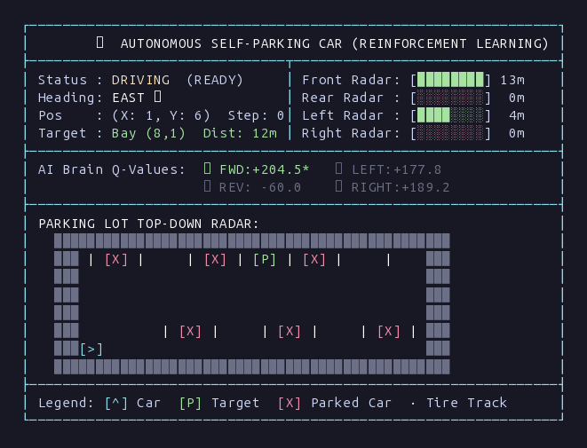

# 🚗 Autonomous Self-Parking Car (ASCII Graphics & Q-Learning)

A Python script where an autonomous car learns the geometry of a parking lot via **Tabular Reinforcement Learning (Q-Learning)** and parks itself in real time using **retro ASCII / ANSI terminal graphics**.

Built using **100% Python standard library** (no external packages or pip dependencies required).

---

<!-- Animated Demo GIF: Place autopark.gif in the repo root to display -->
<p align="center">
  
</p>

---

## 📸 Key Features

- **Top-Down ASCII Parking Lot Radar**: Displays walls (`███`), parking stall dividers (` | `), other parked obstacle cars (`[X]`), the target parking bay (`[P]`), and the autonomous vehicle (`[^]`, `[>]`, `[v]`, `[<]`).
- **Dynamic Tire Tracks**: Leaves a trail (`·`) showing the exact maneuver trajectory the car took.
- **Simulated LIDAR / Proximity Sensors**: Real-time raycasting in 4 directions (Front, Rear, Left, Right) with visual bar meters (`[████░░░░] 4m`).
- **AI Brain Telemetry**: Live Q-value readouts for each potential maneuver (`FORWARD`, `REVERSE`, `TURN LEFT`, `TURN RIGHT`), highlighting the AI's chosen decision in real time.
- **True Car Physics & Non-Holonomic Constraints**: The car cannot move sideways; it must steer, drive forward, or reverse to position itself properly into the stall.
- **Multiple Interactive Modes**:
  1. **Demo Mode**: Instant 0.04-second training + smooth animated parking demonstration.
  2. **Live Training Mode**: Watch the car learn live from scratch (from initial random collisions to expert precision).
  3. **Multi-Spot Challenge**: Spawns the car at 5 random locations across the lot to prove it can park from anywhere.
  4. **Evolution Showcase**: Compares snapshots of generations (Rookie → Learner → Proficient → Master).

---

## 🕹️ Quick Start

Run the simulation directly:

```bash
python3 autopark.py
```

### Command Line Options

```bash
# Run with slower or faster animation speed (seconds per step)
python3 autopark.py --speed 0.15

# Watch the AI learn live in real time (exploring and improving)
python3 autopark.py --mode live-train

# Challenge the AI from 5 randomized starting locations
python3 autopark.py --mode random

# View the evolutionary stages of AI training
python3 autopark.py --mode evolution

# Disable ANSI colors (for monochrome or basic terminals)
python3 autopark.py --no-color
```

---

## 🎥 How to Create & Export an Animated GIF

Want to generate `autopark.gif` to showcase in your GitHub repository? Choose any of these 3 easy methods:

### Option 1: Python Script (`record_gif.py`)
Run the bundled recorder script (requires Pillow):
```bash
pip install pillow
python3 record_gif.py --output autopark.gif
```
> **Bonus:** This also creates `autopark_player.html`, an interactive web player you can open in Chrome, Firefox, or Safari with play/pause and speed controls!

### Option 2: VHS by Charm (High-DPI Terminal GIF)
If you have [vhs](https://github.com/charmbracelet/vhs) installed, run the bundled `.tape` file:
```bash
vhs autopark.tape
```

### Option 3: Screen-to-GIF Desktop Recorders
- **Linux**: Install **Peek** (`sudo apt install peek`), drag the window over your terminal, and hit **Record as GIF**!
- **macOS**: Use [Kap](https://getkap.co/) or **LICEcap**.
- **Windows**: Use [ScreenToGif](https://www.screentogif.com/).

---

## 🧠 How the Machine Learning Works

### 1. State Space $S = (x, y, \theta)$
- $x \in [0, 15]$: Horizontal position in the parking lot grid.
- $y \in [0, 7]$: Vertical position in the parking lot grid.
- $\theta \in \{0, 1, 2, 3\}$: Car orientation (0: North, 1: East, 2: South, 3: West).

### 2. Action Space $A$
- **0 - FORWARD**: Advances 1 cell in the current heading direction.
- **1 - REVERSE**: Moves 1 cell backwards opposite to current heading direction.
- **2 - TURN LEFT**: Rotates 90° counter-clockwise.
- **3 - TURN RIGHT**: Rotates 90° clockwise.

### 3. Reward Function $R(s, a, s')$
- **Successful Park in Bay `[P]`**: $+280$ (with bonus for proper head-in alignment).
- **Collision with Wall or Parked Car**: $-60$ (episode terminates immediately).
- **Step Penalty**: $-1.0$ per move (encourages finding the shortest path).
- **Distance Shaping**: $+0.6 \times (\Delta \text{Manhattan Distance})$ toward target.
- **Reverse Penalty on Road**: $-0.3$ (encourages realistic forward road cruising).

### 4. Q-Value Bellman Update
$$Q(s, a) \leftarrow Q(s, a) + \alpha \left[ R + \gamma \max_{a'} Q(s', a') - Q(s, a) \right]$$
- Learning rate $\alpha = 0.20$
- Discount factor $\gamma = 0.98$
- Epsilon-greedy exploration $\epsilon$ decaying from $1.0$ (100% exploration) to $0.02$ (exploitation).

---

## 📚 Deep-Dive Guide
For complete mathematical explanations, architecture diagrams, and custom map tutorials, check out [guide.md](guide.md).
