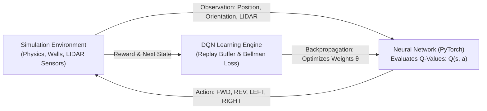

# 🚗 Autonomous Self-Parking Car: AI & Architecture Concepts

This document explains the core theoretical and architectural principles behind this project, covering how Reinforcement Learning (RL) works, why neural networks differ fundamentally from state machines, and how model persistence operates.

---

## 1. Is Reinforcement Learning Just a State Machine or Random Trial-and-Error?

A common question when approaching this project is:
> *"Are these libraries just state machines where scripts test random states until they find the one with the highest success rate?"*

The short answer is **no**. While initial training begins with exploratory moves, the underlying mechanics are fundamentally different from both brute-force search and finite state machines.

---

## 2. Why It Is Not Brute-Force Random Search

If the car relied solely on random trial-and-error:
- In a complex parking lot with obstacles, dividers, and walls, the probability of stumbling into the parking bay through random steering would be less than **1 in a billion**.
- The car would fail to repeat the maneuver if spawned in a slightly different position or heading.

Instead of brute force, the agent learns through **Temporal Credit Assignment** governed by the **Bellman Optimality Equation**:

$$Q(s, a) \leftarrow r + \gamma \max_{a'} Q(s', a')$$

### The "Breadcrumb" Effect (Backpropagating Future Rewards)
1. **Initial Exploration ($\varepsilon = 1.0$)**: The agent takes random actions to explore the environment.
2. **First Breakthrough**: When the car finally reaches a parking stall and receives a large positive reward ($+280$), the action taken immediately before parking is marked as highly valuable.
3. **Temporal Chaining**: In subsequent episodes, actions leading up to that penultimate state also acquire value through the discount factor $\gamma$.
4. **Optimal Policy**: Over successive iterations, a continuous gradient of expected rewards flows backwards from the parking bay to the entrance gate. The car no longer guesses; it simply follows the path of steepest expected return.

---

## 3. Tabular Lookup vs. Deep Neural Networks (Generalization)

| Feature | Tabular Q-Learning (`autopark.py`) | Deep Q-Network (`autopark_pytorch.py`) |
| :--- | :--- | :--- |
| **State Space** | Discrete hash map: `q_table[(x, y, o)]` | Continuous feature vector: $[x, y, \mathbf{u}_{\text{target}}, \mathbf{h}_{\text{one-hot}}, \mathbf{d}_{\text{LIDAR}}]$ |
| **Nature of Model** | Discrete Markov Decision Process (MDP) | Universal Continuous Function Approximator ($Q_\theta(s, a)$) |
| **Unseen States** | Starts at 0.0 with zero prior knowledge | **Generalizes** smoothly using continuous spatial geometry |
| **Runtime Storage** | In-memory Python dictionary | Compact binary tensor weights checkpoint (`.pt`) |

### The Power of Neural Generalization
A traditional state machine requires manually programmed rules for every condition:
```python
# Traditional State Machine (brittle; fails on unexpected inputs)
if lidar_front < 2 and target_is_right:
    turn_right()
```

In contrast, **PyTorch Deep Q-Networks** do not memorize individual grid coordinates:
- The network processes continuous floating-point features (normalized coordinates, relative vectors to the target bay, vehicle heading, and multi-directional LIDAR raycasts).
- Through **gradient descent (Backpropagation)**, the neural network adjusts its internal weight matrices to extract underlying geometric principles.
- If the vehicle is spawned at a location or angle it has **never seen during training**, the neural network can still successfully steer and park because it has learned the continuous spatial relationship between obstacle clearances, target vectors, and steering actions.

---

## 4. The Roles of the AI Libraries



1. **The Environment (`ParkingEnvironment`)**:
   - Represents the physical world. It governs collision detection, raycasts simulated LIDAR distances, and evaluates task completion.
2. **PyTorch (`torch`)**:
   - Acts as the numerical linear algebra and automatic differentiation engine. It does not possess inherent knowledge of cars or parking; it optimizes mathematical tensors to minimize the Bellman loss.
3. **The Reinforcement Learning Engine (`DQNAgent`)**:
   - Manages exploration schedules ($\varepsilon$-decay), stores transition memories in a circular **Experience Replay Buffer** to break temporal correlation, and stabilizes learning via **Target Network Soft-Updates** (Polyak averaging $\tau = 0.005$).

---

## 5. Model Persistence: Training vs. Instant Inference

A critical advantage of deep learning frameworks is **model serialization**:

### What Gets Saved?
The outcome of training is not a recording of past movements. It is the network's calibrated **parameters** (weight matrices and bias vectors, called `state_dict` in PyTorch).
- At the end of training, the agent invokes `agent.save("autopark_dqn.pt")`.
- This writes a lightweight binary file containing the neural network's parameters.

### Instant Inference (Zero Recalculation)
By launching with the `--load` flag:
```bash
uv run python autopark_pytorch.py --load
```
1. Training is completely bypassed (0 training episodes executed).
2. The pre-trained parameters are loaded directly into the network via `torch.load()`.
3. The network enters evaluation mode (`model.eval()`).
4. The car drives and parks autonomously in real time with zero training latency.

---

## 6. Flexible Map Architecture & Multiple Parking Bays (`P`)

The simulation decouples parking layouts from the Python source code using plain-text ASCII maps ([`default_map.txt`](file:///home/vgalo/Sandbox/machine_learn_car/default_map.txt)):

```text
################
#|C|P|C|P|C|P| #
#              #
#              #
#              #
#   |C| |C| |C|#
#S             #
################
```

- **Multiple Target Bays**: The environment parses all `'P'` symbols dynamically into `env.targets`.
- **Dynamic Closest Target**: The distance-shaping reward and the HUD radar dynamically lock onto the closest bay using Manhattan distance:
  $$\text{closest\_target}(x, y) = \arg\min_{(t_x, t_y) \in \text{targets}} (|x - t_x| + |y - t_y|)$$
- **Custom Maps**: Users can supply custom layouts via the CLI:
  ```bash
  uv run python autopark.py --map custom_map.txt
  uv run python autopark_pytorch.py --map custom_map.txt
  ```
